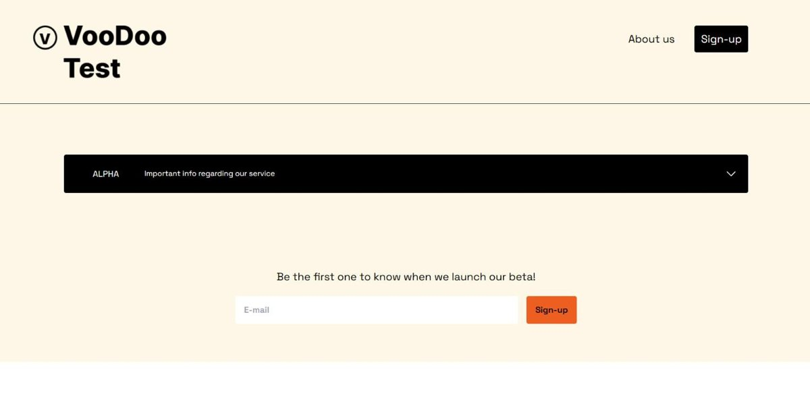

# VooDoo — Test Task

Landing page built as a test task: responsive layout with Tailwind CSS and a product grid loaded from the Shopify Storefront JSON (`products.json`) with vanilla JavaScript.

**Live demo:** https://chaika911.github.io/VooDoo_test_work/



## Stack

- HTML5
- Tailwind CSS 3 (+ `@tailwindcss/typography`)
- JavaScript (ES6 classes, Fetch API)

## Features

- Collapsible info banner
- Product cards rendered from the Shopify API
- E-mail sign-up form
- Responsive header and footer

> The Shopify sandbox store used in the task has since been closed, so the product grid now shows a fallback message.

## Run locally

```bash
npm install
npm start   # Tailwind watch: input.css -> css/style.css
```

Then open `index.html` in the browser.

## Author

Vitalii Chaika — [portfolio](https://chaika911.github.io/myCV/) · [LinkedIn](https://www.linkedin.com/in/vitalii-chaika-dev/)
